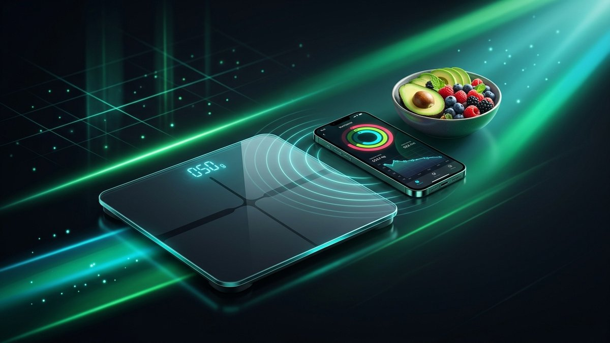

# 🥑 FoodVisionAI-iOS

> **Lightweight, privacy-first AI Food Vision & Macro Nutrition pipeline for iOS.**  
> Powered by Multimodal Vision LLMs, SwiftUI Bento architecture, and Apple HealthKit auto-synchronization.

[](https://developer.apple.com/ios/)
[](https://swift.org)
[](https://opensource.org/licenses/MIT)
[](https://apps.apple.com/us/app/nady-ai-calorie-photo-track/id6740164035)


<p align="center">
  
</p>
---

## 📱 Live Production App: NadY

This architecture is in production inside **[NadY: Photo Calorie Tracker](https://apps.apple.com/us/app/nady-ai-calorie-photo-track/id6740164035)** on the Apple App Store.

* **1-Second Photo Scan:** Snap any complex meal, plate, or restaurant takeout.
* **Discrete Segmentation:** Automatically identifies sauces, cuts of meat, carbs, and dressings.
* **Apple HealthKit Sync:** Automatically syncs active energy deficit, dietary energy, protein, fat, and carbohydrates.
* **Bento UI 2026:** Single-screen viewport with net calorie tracking, water intake, and circadian 16:8 intermittent fasting timer.

👉 **[Download NadY on the App Store (iOS)](https://apps.apple.com/us/app/nady-ai-calorie-photo-track/id6740164035)**

---

## 🔬 Architecture Overview

```
                      +------------------------+
                      |  iOS Camera / Library  |
                      |   (AVFoundation / PH)  |
                      +-----------+------------+
                                  | High-Res Frame
                                  v
                      +------------------------+
                      |  Local Pre-Processing  |
                      |  - Aspect Normalization|
                      |  - Exposure Correction |
                      |  - Ephemeral Memory    |
                      +-----------+------------+
                                  | Base64 Payload
                                  v
                      +------------------------+
                      |  Multimodal Vision AI  |
                      |  - Plate Segmentation  |
                      |  - Volumetric Density  |
                      |  - KBZHU Macro Parser  |
                      +-----------+------------+
                                  | Structured JSON
                                  v
           +----------------------+----------------------+
           |                                             |
           v                                             v
+------------------------+                    +------------------------+
|  Bento UI HUD (SwiftUI)|                    |  Apple HealthKit Sync  |
|  - Realtime Net Deficit|                    |  - Dietary Energy (cal)|
|  - Macro Ring Visuals  |                    |  - Protein, Fat, Carbs |
|  - 16:8 Fasting State  |                    |  - Passive Burn Reconc.|
+------------------------+                    +------------------------+
```

---

## 🚀 Quick Start (Swift Package Manager)

Add `FoodVisionAI` to your `Package.swift`:

```swift
dependencies: [
    .package(url: "https://github.com/UniversalSDK/FoodVisionAI-iOS.git", from: "1.0.0")
]
```

### 1. Meal Recognition Pipeline

```swift
import SwiftUI
import FoodVisionAI

struct FoodScanView: View {
    @State private var scanResult: MealMacroEstimation?
    @State private var isProcessing = false
    
    var body: some View {
        VStack {
            if let result = scanResult {
                MealSummaryCard(result: result)
            } else {
                Text("Snap a meal to see instant macros")
            }
        }
    }
    
    func analyzeMeal(image: UIImage) async {
        isProcessing = true
        defer { isProcessing = false }
        
        do {
            let result = try await FoodVisionEngine.shared.analyze(
                image: image,
                dietaryContext: .standardDeficit
            )
            self.scanResult = result
            
            // Auto-sync to HealthKit
            try await HealthKitNutritionSync.shared.recordMeal(result)
        } catch {
            print("Scan failed: \(error.localizedDescription)")
        }
    }
}
```

### 2. Apple HealthKit 2-Way Sync

```swift
import HealthKit

public final class HealthKitNutritionSync {
    public static let shared = HealthKitNutritionSync()
    private let healthStore = HKHealthStore()
    
    public func recordMeal(_ meal: MealMacroEstimation) async throws {
        guard HKHealthStore.isHealthDataAvailable() else { return }
        
        let now = Date()
        var samples: [HKQuantitySample] = []
        
        // 1. Dietary Energy (Calories)
        let energyType = HKQuantityType.quantityType(forIdentifier: .dietaryEnergyConsumed)!
        let energyQuantity = HKQuantity(unit: .kilocalorie(), doubleValue: meal.calories)
        samples.append(HKQuantitySample(type: energyType, quantity: energyQuantity, start: now, end: now))
        
        // 2. Macronutrients
        let proteinType = HKQuantityType.quantityType(forIdentifier: .dietaryProtein)!
        samples.append(HKQuantitySample(type: proteinType, quantity: HKQuantity(unit: .gram(), doubleValue: meal.protein), start: now, end: now))
        
        let fatType = HKQuantityType.quantityType(forIdentifier: .dietaryFatTotal)!
        samples.append(HKQuantitySample(type: fatType, quantity: HKQuantity(unit: .gram(), doubleValue: meal.fat), start: now, end: now))
        
        let carbType = HKQuantityType.quantityType(forIdentifier: .dietaryCarbohydrates)!
        samples.append(HKQuantitySample(type: carbType, quantity: HKQuantity(unit: .gram(), doubleValue: meal.carbs), start: now, end: now))
        
        try await healthStore.save(samples)
    }
}
```

---

## 🔒 Privacy & Clinical Compliance

* **Zero Facial or Ambient Retention:** Camera frames are evaluated solely for food textures, plate geometry, and food components.
* **Ephemeral Processing:** Image buffers exist in volatile RAM only during active inference and are discarded immediately after parsing.
* **Apple Health Guidelines:** All samples adhere to Apple Clinical & Dietary Data schema specifications.

---

## 👨‍💻 Community & Live Support

* Official iOS App: **[NadY: Photo Calorie Tracker on App Store](https://apps.apple.com/us/app/nady-ai-calorie-photo-track/id6740164035)**
* Developed by **UniversalSDK** / **NadY Diet AI Team**.
* Issues & Contributions: Open an issue or pull request!

---

## 📄 License

MIT License. See LICENSE for details.
